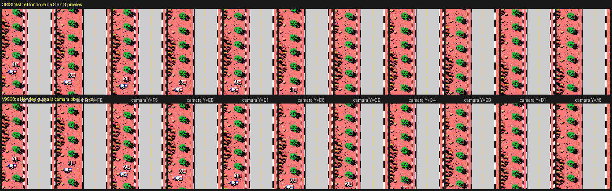

# F-1 Spirit con scroll suave para el V9968

Un parche para F-1 Spirit (Konami, 1987) que usa el **V9968** (el VDP
compatible con el V9958 de HRA!) para que el fondo de la pista se mueva
**pixel a pixel** en vez de a saltos de 8 pixeles. La logica del juego no se
toca: en la demo, la carrera va paso a paso igual que el original.

## Construir y probar

Hace falta `f1spirit.rom` en la raiz (la original, sha256 `3b9afd12...96a7`),
`python3` y `pasmo`:

    make v9968        # -> f1spirit_v9968.rom (256 KB)
    python3 -m unittest tests.test_v9968 -v

La ROM parcheada mide **256 KB** (la original, 128): lleva una pagina nueva.
Sigue siendo un MegaROM con el mapper Konami SCC; en openMSX hay que decirlo
(`-romtype KonamiSCC`), porque la base de datos no la conoce.

Para verla en openMSX hace falta un emulador con el V9968: el fork de buppu3
(`https://github.com/buppu3/openMSX`, probado en `24d261cb`). En
`v9968/openmsx/` esta la maquina que se ha usado, un MSX2+ con C-BIOS y el
V9968 en lugar del V9958 (copiala a `share/machines/`):

    openmsx -machine CBIOS_MSX2P_V9968 -cart f1spirit_v9968.rom -romtype KonamiSCC

En cualquier otra maquina la ROM parcheada funciona como la original:
comprobado en MSX1, MSX2 (V9938) y MSX2+ (V9958) con la demo, paso a paso
(camara, coche del jugador y estado del juego iguales) y al mismo ritmo: los
ganchos cuestan algun ciclo y algun paso sale un fotograma antes o despues
(como mucho tres en algun momento), pero la carrera acaba a la vez.

## Que se ve

- **Scroll vertical fino** en la ventana de la pista con un jugador. El
  horizontal sigue siendo por columnas, como en el original.
- **16 sprites por linea** (bit S16 del V9968): menos parpadeo cuando se
  juntan coches. Se quita con `V9968_S16 equ 0` en `comun.asm`.
- La imagen se actualiza sin cortes: las tiras de cada tercio estan en la
  VRAM antes de que el haz llegue a el (el de arriba, en mas del 90 % de los
  repintados; los otros dos, casi siempre).
- Todo lo demas (menus, boxes, repeticion, pantalla partida de dos jugadores)
  va como siempre.

## Como funciona

La ventana de la pista son 15 x 24 tiles que el juego copia de un buffer
circular de 32 x 32 (E400) a la tabla de nombres. La camara (E300) va pixel a
pixel, pero el fondo solo se puede mover de 8 en 8. El registro de scroll
vertical (R#23) no vale: moveria tambien el marcador, que esta al lado.

**Tiras.** En modo fino cada columna de la ventana, en cada tercio de la
pantalla, tiene ocho patrones propios y seguidos: 64 bytes que son 64 lineas
de pixeles de esa columna. Con R#25 CMD = 1 los comandos del VDP funcionan en
SCREEN 2 con coordenadas de SCREEN 8, y esos 64 bytes son un rectangulo de
64 x 1. Un **mapa de la pista** en la VRAM alta guarda cada columna del buffer
(256 lineas) en una fila de 256 bytes; hacer scroll es copiar con HMMM desde
la linea que diga la camara: 18 comandos por repintado (3 tercios x 3 grupos
de 5 columnas x patrones y colores). La tabla de nombres de la ventana queda
fija.

**Celdas.** El mapa se rellena tile a tile (dos HMMM de 8 x 1 por celda)
desde las tablas del juego, que no se tocan nunca y hacen de **atlas**. Solo
cuando hace falta: al entrar en la carrera (40 celdas por repintado, con el
scroll de siempre mientras tanto), cuando el juego pinta una fila nueva (se
rellena mientras esta oculta, antes de que entre) y cuando la ventana se
mueve una columna (cada fila lleva una columna de margen a cada lado, asi que
la que entra ya esta; solo falta la nueva de margen). Lo que el juego repinta
en una fila que aun se ve (la de abajo del todo) se aplaza hasta que deja de
verse.

**VRAM.**

| | |
|---|---|
| 0x00000-0x03FFF | las tablas del juego: el atlas (sin tocar) |
| 0x10000-0x117FF | colores propios (R#3 = 0x7F, R#10 = 0x04) |
| 0x12000-0x137FF | patrones propios (R#4 = 0x27) |
| 0x14000-0x15FFF | el mapa: patrones, una fila de 256 bytes por columna del buffer |
| 0x16000-0x17FFF | el mapa: colores |

Las filas de patrones que usa el marcador (0x00-0x1F y 0xC0-0xFF) se copian
del juego a las tablas propias al entrar en modo fino.

**El tiempo.** El juego da un paso de logica cada tres interrupciones (el
contador F0FC) y repinta dentro de la interrupcion; el original tarda poco y
el renderer bastante mas. Para que el ritmo sea el mismo:

- Con el V9968, el repintado (sprites, ventana y marcador) se hace al
  principio de la interrupcion, **antes del sonido** (0x4046), y las tiras del
  tercio de arriba incluso antes que los sprites (`V9_ANTES`). El sonido se
  retrasa unos milisegundos en esas interrupciones.
- Lo que no se ve (filas ocultas, columna de margen) va despues del sonido
  (0x405A).
- Una interrupcion que llega mientras se repinta no se pierde: el juego la
  despacharia sin sonido y sin contarla; en su salida (0x40B5) se hace su
  paso de sonido y se cuenta en el reloj (`V9_ANIDADA`), con cuidado de que
  el `F0FC = 0` de cada paso no se la coma.

**Deteccion.** Al arrancar se mira la version de MSX (2 o mas), el ID del VDP
(S#1) y, con R#21 V58 = 0, si es un V9968 (ID 3). Solo entonces se pone el
modo fino, con los comandos rapidos (R#20 HS) y S16. Con un V9958 no da
tiempo: la carrera bajaria a unos 12 pasos por segundo en vez de 20, asi que
se queda con el scroll de siempre (`V9958_FINO equ 1` en `comun.asm` para
probarlo igualmente).

## Donde esta cada cosa

| | |
|---|---|
| `v9968/comun.asm` | direcciones del juego, ganchos, VRAM, RAM y opciones |
| `v9968/ram.asm` | lo que va en RAM (0xF100): los ganchos de la pagina 0 y el cambio de pagina |
| `v9968/parche.asm` | los ganchos sobre la pagina 0, la pagina 15 (arranque y recuperacion de interrupciones) y la pagina 16 nueva (el renderer) |
| `tools/parchea_v9968.py` | monta la ROM y comprueba que nada cambia fuera de las zonas declaradas |
| `tests/test_v9968.py` | cada direccion de `comun.asm` contra el listado, y la ROM montada |

La ROM: la pagina 0 lleva 16 ganchos de 3 a 5 bytes (cada uno tapa una
instruccion que se rehace fuera); el hueco a 0xFF de la pagina 15
(0xBC84-0xBF4F) lleva el arranque, la recuperacion de interrupciones y la
imagen de la RAM; la pagina 16 (nueva, se mapea en 0x6000 solo mientras se
usa) lleva el renderer. La RAM del parche va de 0xF100 a 0xF37F: el juego usa
hasta 0xF0FF y la BIOS empieza en 0xF380.

## Como se ha comprobado

Todo en el emulador (el fork de openMSX), con la demo del juego:

- **Logica**: la RAM del juego (0xE1C0-0xEFFF) en cada paso, contra la ROM
  original en la misma maquina: identica en todos (solo cambia el estado del
  reproductor de sonido, 0xE000-0xE1BF, y su cola de ordenes, porque el paso
  de sonido cae en otro momento). El marcador y la tabla de sprites en la
  VRAM, identicos tambien.
- **Imagen**: la ventana que muestra el VDP, pixel a pixel, contra la que
  sale del buffer E400 y la camara: 267.542 lineas de tile bien y ninguna
  mal en dos carreras de la demo (un 1,5 % tiene la variante de otro tercio,
  ver abajo).
- **Ritmo**: 20 pasos por segundo, como el original, con algun segundo de 18
  o 19 en las curvas mas cerradas. En la carrera de la demo (unos 30 s) llega
  a la meta unos 0,25 s despues que el original.

## Limitaciones

- **Solo V9968 en el sitio del VDP** (puertos 0x98-0x9C). El V9968 en
  cartucho (0x88) no esta soportado.
- **Un jugador**: la pantalla partida de dos jugadores, las escenas fijas,
  los boxes y la repeticion van con el scroll de siempre.
- **Tiles con un dibujo por tercio.** En SCREEN 2 cada tercio de la pantalla
  tiene sus propios patrones, y el juego usa eso en algunos tiles (las
  lineas del borde de la pista, el cartel de RAYS): el mismo numero de tile
  se ve distinto arriba, en medio y abajo. Con scroll fino una fila pasa de un
  tercio a otro poco a poco, asi que se queda con el dibujo del tercio en el
  que se relleno (el de arriba, por donde entran las filas): son uno o dos
  pixeles distintos en la primera o la ultima linea de esos tiles.
- **Sonido**: en las interrupciones en las que se repinta (una de cada
  tres), el paso del reproductor llega hasta unos 7 ms mas tarde. No se ha
  comprobado de oido.
- **Solo probado en emulacion.** La velocidad de los comandos con HS es la
  que emula el fork; en un V9968 de verdad puede ser otra. El candado del
  puerto 4 (bit 7), que el RTL pide para escribir R#20/R#21, se quita y se
  vuelve a poner como dice su documentacion, pero el fork no lo emula.
- **ROM de 256 KB**: hace falta un cartucho flash o un emulador que la
  acepte con el mapper Konami SCC.
